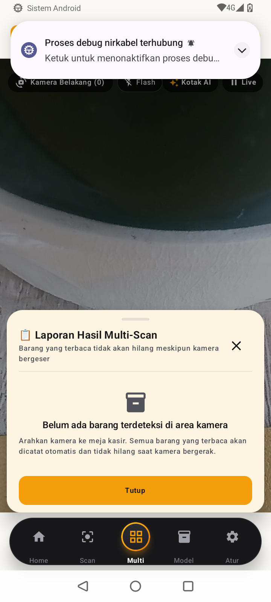
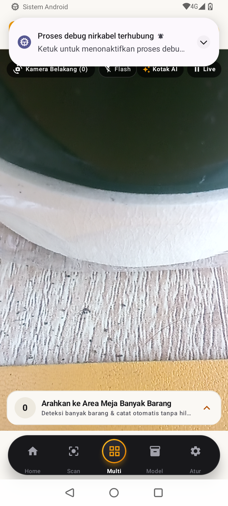
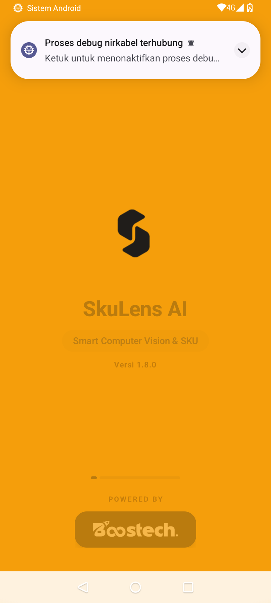
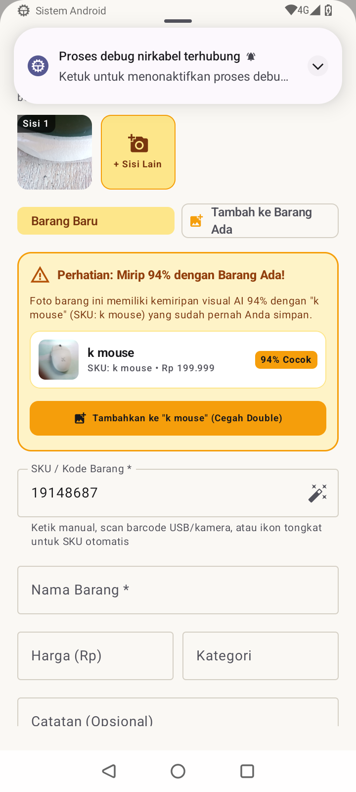
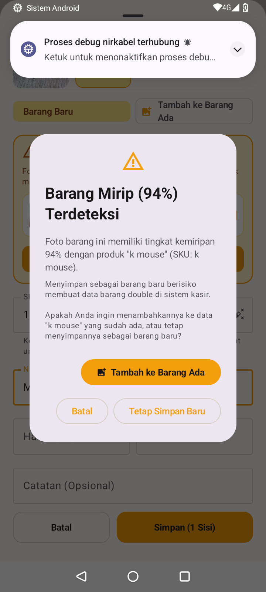
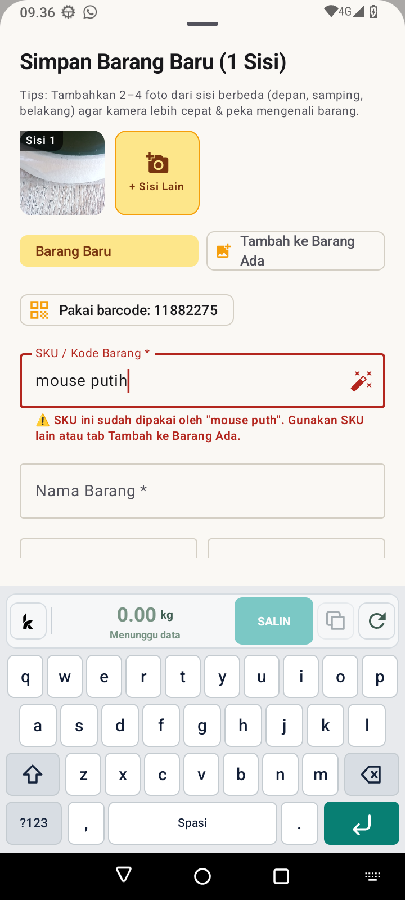
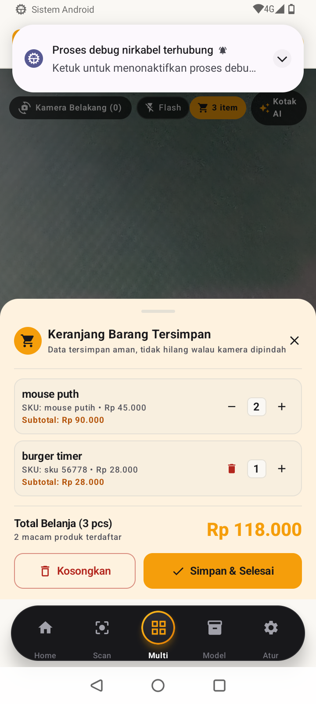
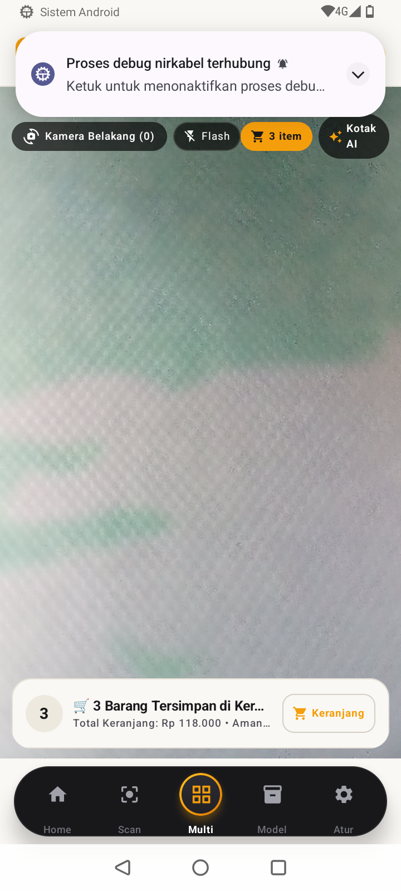
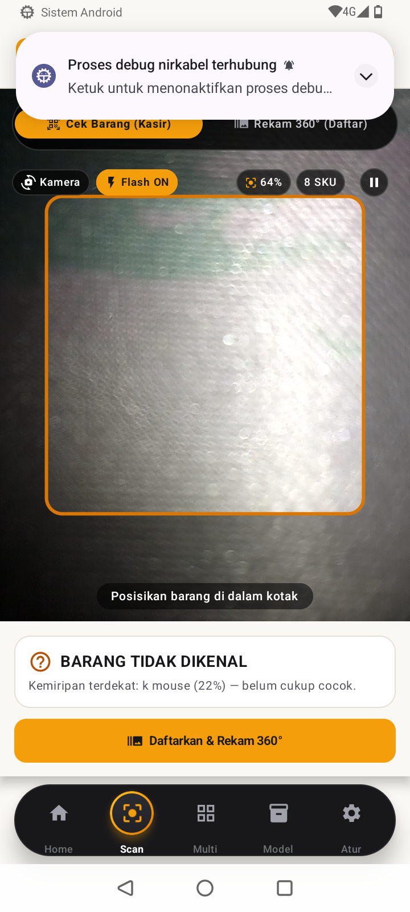

<div align="center">
  
  <h1>SkuLens AI</h1>
  <p><strong>Smart Computer Vision &amp; SKU Recognition untuk Perangkat Android &amp; iMin POS</strong></p>

  <p>
    
    
    
    
  </p>

  <p>
    <a href="releases/SkuLens-AI-v1.8.0.apk"><strong>⬇️ Unduh APK Langsung (v1.8.0 — 97.09 MB)</strong></a>
    &nbsp;•&nbsp;
    <a href="https://github.com/hello-droid-kid/skulens-ai/releases/tag/v1.8.0"><strong>📦 Halaman Release</strong></a>
    &nbsp;•&nbsp;
    <a href="CHANGELOG.md"><strong>📝 Catatan Rilis</strong></a>
  </p>
</div>

---

## Ringkasan

**SkuLens AI** adalah aplikasi Android Computer Vision **100% offline** untuk mengenali barang secara real-time melalui kamera, mengelola katalog **Nama + SKU + Harga + Foto Sampel** di database lokal SQLite, serta mendukung perangkat kasir **iMin POS** (tanpa Google Play Services / GMS).

> Repositori ini merupakan repositori **rilis & distribusi APK resmi** (tanpa source code).

---

## Unduh & Instalasi

| Item | Detail |
| --- | --- |
| **Nama Aplikasi** | SkuLens AI (`com.harapan.kenalbarang`) |
| **Versi** | `v1.8.0` (Build 11 — Universal Debug APK) |
| **Ukuran File** | `97.09 MB` (`SkuLens-AI-v1.8.0.apk`) |
| **Minimal OS** | Android 7.0 (API 24) ke atas, diuji langsung di iMin Swift 2 Pro (Android 13) |
| **File APK** | [`releases/SkuLens-AI-v1.8.0.apk`](releases/SkuLens-AI-v1.8.0.apk) |
| **SHA-256** | `12398B98BA0CEFAECE82B260A5DC42CF415C483FC2680D1155F8F069C4B2E941` |

### Cara Install di HP Android / Perangkat iMin POS

1. Unduh [`releases/SkuLens-AI-v1.8.0.apk`](releases/SkuLens-AI-v1.8.0.apk) langsung di perangkat (atau lewat halaman [Releases](https://github.com/hello-droid-kid/skulens-ai/releases)).
2. Buka file APK dan aktifkan izin **Install dari sumber tidak dikenal** (*Install unknown apps*) jika diminta.
3. Buka **SkuLens AI** dan berikan izin **Kamera** saat pertama kali dijalankan.

*(Opsional via ADB dari PC / Wireless Debugging)*:
```bash
adb install -r SkuLens-AI-v1.8.0.apk
```

---

## Tampilan Aplikasi (Diuji di iMin Swift 2 Pro)

| Drawer Laporan Multi-Scan | Live Multi Area Meja | Dashboard Vision v1.8.0 |
| :---: | :---: | :---: |
|  |  |  |

| Peringatan Mirip 90%+ | Dialog Konfirmasi Duplikasi | Validasi SKU Duplikat |
| :---: | :---: | :---: |
|  |  |  |

| Keranjang Multi Tersimpan | Multi Area & HUD Keranjang | Cek Barang & Flash On |
| :---: | :---: | :---: |
|  |  |  |

---

## Fitur Utama

- **Penyimpanan Keranjang Multi-Scan (Anti-Hilang)**:
  - Tombol instan `[ 💾 Simpan ]` di bar bawah dan drawer untuk mengunci & menyimpan barang yang terdeteksi di area meja kasir.
  - **Data Tidak Pernah Hilang**: Hasil deteksi barang tersimpan secara persisten di penyimpanan lokal, tidak hilang saat barang diangkat, kamera dipindah, atau saat berganti tab aplikasi.
  - **Kelola Kuantitas**: Modal keranjang interaktif untuk menambah `[+]`, mengurangi `[-]`, atau menghapus item `[🗑️]` secara langsung.
  - **Kalkulasi Otomatis**: Rekapitulasi jumlah pcs dan total tagihan rupiah otomatis. Tombol `[ 🗑️ Kosongkan ]` dengan dialog konfirmasi saat transaksi selesai.
  - **Badge Navigasi**: Tab Multi pada navbar menyalakan titik oranye jika ada barang tersimpan di keranjang.
- **Lampu Flash Kamera Hardware (LED Senter)**: Tombol cerdas `[ ⚡ Flash ]` di HUD kamera yang otomatis aktif jika perangkat memiliki lampu kilat kamera belakang (seperti pada iMin Swift 2 Pro), membantu pengenalan akurat di ruangan minim cahaya.
- **Kontrol Jeda (Pause) Rekam 360° Terpadu**:
  - Tombol Mengambang `[ ⏸️ Jeda Auto ]` / `[ ▶️ Lanjut Auto ]` langsung di viewport kamera untuk membekukan jepretan otomatis saat memutar barang.
  - Tombol manual `[ 📸 Jepret Sisi Ini ]` untuk mengambil satu sudut tertentu secara presisi.
  - Interval tangkapan otomatis dioptimalkan (1,4 detik) dengan deteksi kebaruan sudut visual (novelty threshold) agar terhindar dari pemotretan beruntun (*burst*) yang tidak diinginkan.
- **Pemisahan Mode Alur Kerja Jelas**:
  - **Cek Barang (Kasir)**: Khusus scan cepat barang yang sudah ada. Mengeluarkan kartu SKU & harga langsung di layar. Jika barang belum terdaftar, terdapat tombol cepat satu klik `[ Daftarkan & Rekam 360° ]`.
  - **Rekam 360° (Daftar Produk Baru)**: Studio khusus pendaftaran barang baru dengan panduan cincin 8 sisi, kontrol jeda/lanjut, thumbnail strip, dan form pengisian SKU.
- **Floating Wave Navbar Luas & Lega**: Logo pada navbar bawah dilepas sehingga seluruh ruang horizontal terisi merata untuk 5 menu utama (**Home**, **Scan**, **Multi**, **Model**, **Atur**) dengan kubah gelombang oranye yang dinamis.
- **Animasi Antarmuka & Navigasi**: Perpindahan antar-halaman halus (slide + fade + scale), judul TopAppBar teranimasi secara vertikal saat berganti menu.
- **Dashboard Analitik Teranimasi**:
  - **Grafik Performa AI (Dual-Ring Donut)**: Cincin teranimasi untuk *Avg Sukses %* dan *Kemiripan AI %*, rasio cocok vs gagal, serta counter live.
  - **Grafik Sudut Data Model (Column Bar Chart)**: Diagram batang tegak naik bertahap untuk kelengkapan sudut model 360° tiap barang (target `4/8` sudut).
- **Pengenalan Barang Real-Time (Offline AI)**: Menggunakan model *on-device* MobileNetV3 + cosine similarity embedding yang langsung berjalan di perangkat tanpa koneksi internet.
- **Deteksi Banyak Barang (Area)**: Mampu mengenali dan menghitung jumlah beberapa barang sekaligus dalam satu frame kamera dengan rincian subtotal di bottom drawer.
- **Drawer Informasi Otomatis**: Saat barang dikenali, panel detail (*bottom drawer*) otomatis naik menampilkan foto, nama produk, **SKU**, harga, kategori, catatan, tingkat kecocokan (`%`), serta tombol **Tambah Sisi** dan **Scan Lagi**.
- **Preset Kepekaan Visual**: Pilih preset **Peka (58%)**, **Normal (64%)**, atau **Ketat (74%)**, serta atur ukuran kotak fokus kamera di tab **Pengaturan**.

---

## Kebutuhan & Dukungan Perangkat iMin POS

- **AOSP Tanpa Google Mobile Services (GMS)**: Berjalan 100% lokal tanpa ketergantungan Google Play Services.
- **Kamera Bawaan & Kamera USB (UVC)**: Mendukung kamera bawaan seri handheld (Swift, M2 Pro, Falcon) maupun webcam eksternal USB UVC pada seri desktop (D2, D3, D4, Swan) via tombol **Ganti Kamera**.
- **Scanner Barcode USB (HID)**: Mendukung barcode scanner eksternal iMin yang bekerja sebagai input keyboard saat mengisi kolom **SKU**.

---

<div align="center">
  <p>Powered by</p>
  <div style="display:inline-block; background:#18181B; padding:12px 24px; border-radius:14px;">
    
  </div>
  <p><strong>Boostech Demo Tech</strong></p>
</div>
