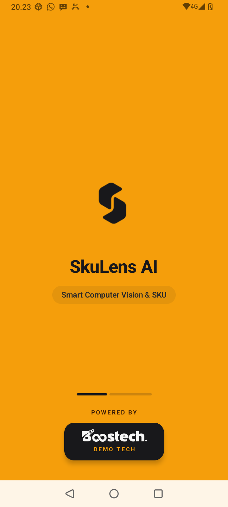
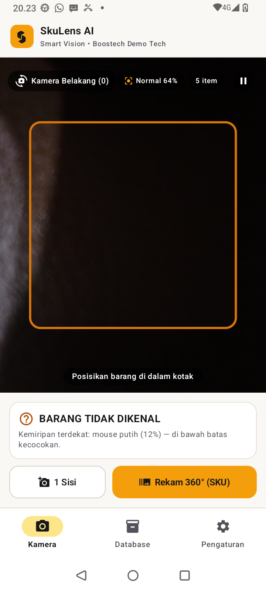
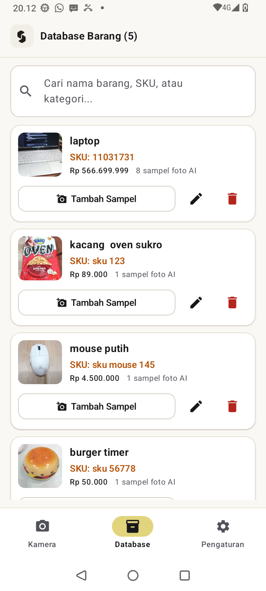
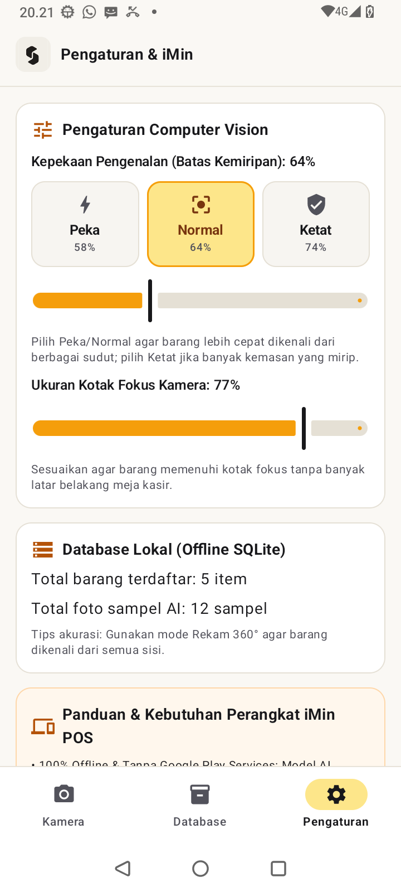

<div align="center">
  
  <h1>SkuLens AI</h1>
  <p><strong>Smart Computer Vision &amp; SKU Recognition untuk Perangkat Android &amp; iMin POS</strong></p>

  <p>
    
    
    
    
  </p>

  <p>
    <a href="releases/SkuLens-AI-v1.0.0.apk"><strong>⬇️ Unduh APK Langsung (v1.0.0 — 92.85 MB)</strong></a>
    &nbsp;•&nbsp;
    <a href="https://github.com/hello-droid-kid/skulens-ai/releases/tag/v1.0.0"><strong>📦 Halaman Release</strong></a>
    &nbsp;•&nbsp;
    <a href="CHANGELOG.md"><strong>📝 Catatan Rilis</strong></a>
  </p>
</div>

---

## Ringkasan

**SkuLens AI** adalah aplikasi Android Computer Vision **100% offline** untuk mengenali barang secara real-time melalui kamera, mengelola katalog **Nama + SKU + Harga + Foto Sampel** di database lokal SQLite, serta mendukung perangkat kasir **iMin POS** (tanpa Google Play Services / GMS).

> Repositori ini merupakan repositori **rilis & distribusi APK resmi** (tanpa source code).

---

## Unduh & Instalasi

| Item | Detail |
| --- | --- |
| **Nama Aplikasi** | SkuLens AI (`com.harapan.kenalbarang`) |
| **Versi** | `v1.0.0` (Build 1 — Universal Debug APK) |
| **Ukuran File** | `92.85 MB` (`SkuLens-AI-v1.0.0.apk`) |
| **Minimal OS** | Android 7.0 (API 24) ke atas, diuji langsung di iMin Swift 2 Pro (Android 13) |
| **File APK** | [`releases/SkuLens-AI-v1.0.0.apk`](releases/SkuLens-AI-v1.0.0.apk) |
| **SHA-256** | `F079BF86D13403317640DFDF4E2A1231415511878FD0CD3E7F06AE27C47E8530` |

### Cara Install di HP Android / Perangkat iMin POS

1. Unduh [`releases/SkuLens-AI-v1.0.0.apk`](releases/SkuLens-AI-v1.0.0.apk) langsung di perangkat (atau lewat halaman [Releases](https://github.com/hello-droid-kid/skulens-ai/releases)).
2. Buka file APK dan aktifkan izin **Install dari sumber tidak dikenal** (*Install unknown apps*) jika diminta.
3. Buka **SkuLens AI** dan berikan izin **Kamera** saat pertama kali dijalankan.

*(Opsional via ADB dari PC)*:
```bash
adb install -r SkuLens-AI-v1.0.0.apk
```

---

## Tampilan Aplikasi

| Splash Screen | Kamera Scanner | Database Barang | Pengaturan & iMin |
| :---: | :---: | :---: | :---: |
|  |  |  |  |

---

## Fitur Utama

- **Pengenalan Barang Real-Time (Offline AI)**: Menggunakan model *on-device* MobileNetV3 + cosine similarity embedding yang langsung berjalan di perangkat tanpa koneksi internet.
- **Drawer Informasi Otomatis**: Saat barang dikenali, panel detail (*bottom drawer*) otomatis naik menampilkan foto, nama produk, **SKU**, harga, kategori, catatan, tingkat kecocokan (`%`), serta tombol **Tambah Sisi** dan **Scan Lagi**.
- **Mode Rekam 360° Otomatis**: Menampilkan panduan langkah sebelum mulai, lalu otomatis memotret hingga **8 sisi berbeda** saat barang diputar perlahan agar pengenalan jauh lebih peka dan cepat dari segala sudut.
- **Database Lokal & Barcode SKU**:
  - Jika barang belum dikenal, ambil foto **1 Sisi** atau **Rekam 360°**, lalu masukkan **Nama Barang**, **SKU** (ketik manual, scan kamera ZXing, auto-generate, atau pakai scanner USB HID), harga, dan kategori.
  - Edit data produk, kelola sampel foto, atau tambah sudut foto baru kapan saja di tab **Database**.
- **Preset Kepekaan Visual**: Pilih preset **Peka (58%)**, **Normal (64%)**, atau **Ketat (74%)**, serta atur ukuran kotak fokus kamera di tab **Pengaturan**.

---

## Kebutuhan & Dukungan Perangkat iMin POS

- **AOSP Tanpa Google Mobile Services (GMS)**: Berjalan 100% lokal tanpa ketergantungan Google Play Services.
- **Kamera Bawaan & Kamera USB (UVC)**: Mendukung kamera bawaan seri handheld (Swift, M2 Pro, Falcon) maupun webcam eksternal USB UVC pada seri desktop (D2, D3, D4, Swan) via tombol **Ganti Kamera**.
- **Scanner Barcode USB (HID)**: Mendukung barcode scanner eksternal iMin yang bekerja sebagai input keyboard saat mengisi kolom **SKU**.

---

<div align="center">
  <p>Powered by</p>
  <div style="display:inline-block; background:#18181B; padding:12px 24px; border-radius:14px;">
    
  </div>
  <p><strong>Boostech Demo Tech</strong></p>
</div>
